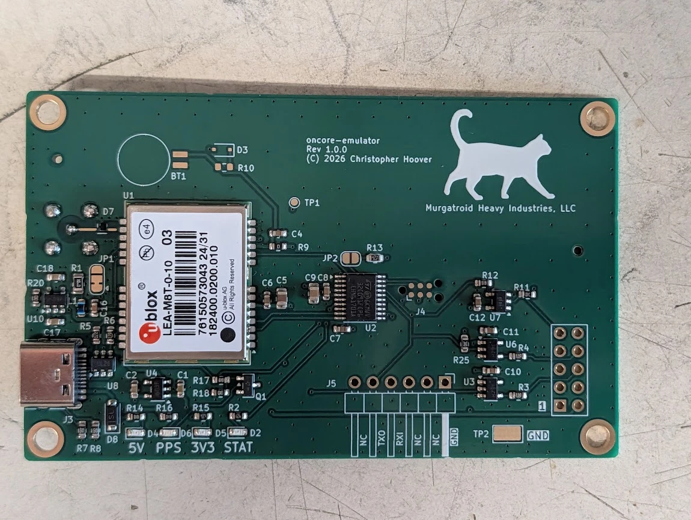
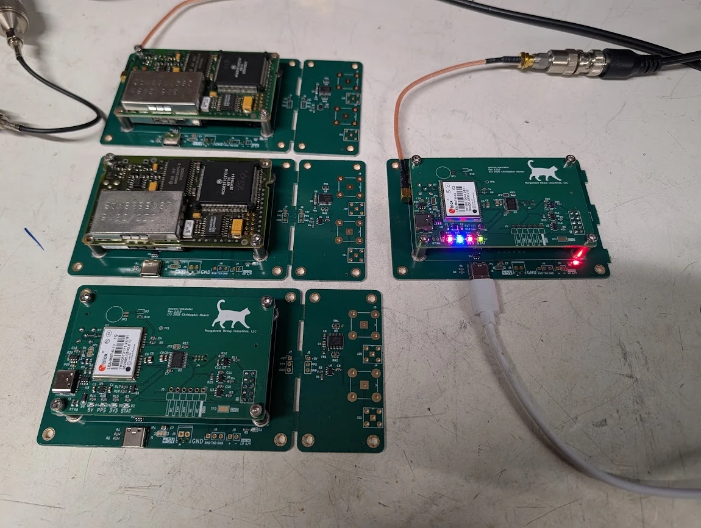

# smartclock-oncore-emulator

*Two VP Oncores (top left) and two boards, each on a test jig.*

A drop-in replacement for the Motorola VP Oncore GPS engine in HP and
Symmetricom SmartClocks: the Z3801A, Z3805A, 58503A and their kin.  A
u-blox LEA-M8T timing module and an STM32C091 speak the Oncore
protocol to the instrument and pass the module's 1 PPS straight
through.

It is not a full Oncore replacement.  It implements exactly the Oncore
messages that every known HP SmartClock firmware sends, each in full,
and no others (`docs/oncore-messages.md`).

## Status

- Firmware [fw-v1.0.0](https://github.com/charlieh0tel/smartclock-oncore-emulator/releases/tag/fw-v1.0.0):
  an image for each receiver model, with SHA256SUMS.
- Every SmartClock image locks in emulation, against the board on
  its test jig
  ([coverage](https://charlieh0tel.github.io/smartclock-oncore-emulator/coverage.html),
  `docs/testing.md`).
- In a 58503A, 16 hours locked with no alarm, its 1 PPS checked
  against a CNS Clock II (`docs/emu-board-bring-up.md`).
- Like a VP Oncore, it has a fixed bias against UTC, tens of
  nanoseconds, which each instrument can trim with
  `:DIAGnostic:TOFFset` (`docs/emu-board-bring-up.md`).
- Board rev 1.0.0.

Boards are not for sale; `hardware/` and `production/` have what is
needed to have one made.

## Layout

| Path | What |
|---|---|
| `hardware/` | KiCad designs: the board and its test jig |
| `production/` | each board's fabrication files (Gerbers, BOM, placement, source) |
| `firmware/` | the Rust firmware and its host tools (`firmware/README.md`) |
| `bench/` | bench tools: flashing, 1 PPS comparison (`bench/README.md`) |
| `docs/` | the messages, the connector, bring-up and test results |
| `PLAN.md` | the design and its reasons |
| `third_party/` | vendor documents (`third_party/NOTICE`) |

## Sources

The protocol is the VP Oncore Command Reference
(`third_party/motorola/VPCommands.pdf`), implemented by smartclock-gps.
How the SmartClock firmware uses it is in
[smartclock](https://github.com/charlieh0tel/smartclock)'s
`docs/firmware/gps.md`.

## License

- Hardware: CERN-OHL-S-2.0 (`hardware/LICENSE`).  Footprints adapted
  from KiCad's library stay CC-BY-SA-4.0; each 3D model keeps its
  source's terms (the `.3dshapes` READMEs); `hardware/ee_tooling` is
  MIT OR Apache-2.0.
- Firmware and documentation: GPL-3.0-only (`LICENSE`).
- `third_party/`: its owners' (`third_party/NOTICE`).

## Contributing

Once per clone: `git submodule update --init` and `make hooks`.
`AGENTS.md` has the rules.
