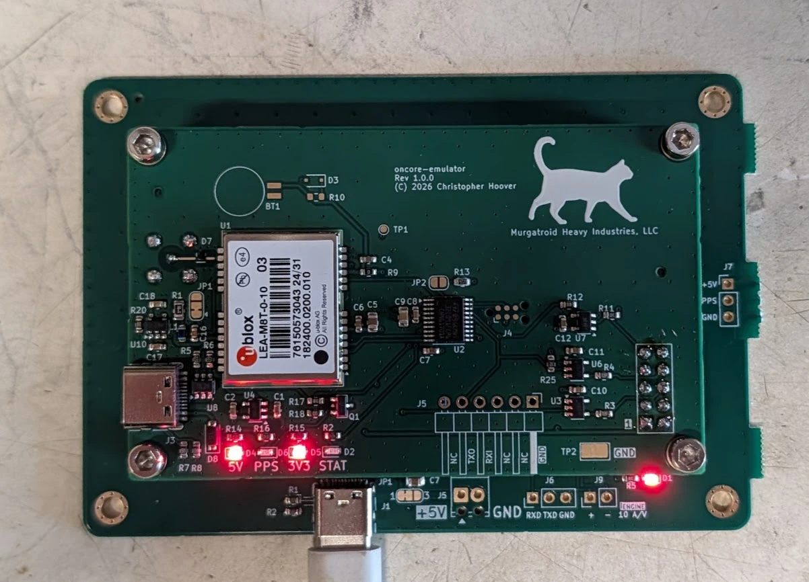

# Testing

[Coverage by
instrument](https://charlieh0tel.github.io/smartclock-oncore-emulator/coverage.html)
(`docs/coverage.html`, generated by `firmware/tools/coverage.py` from
`docs/coverage.json`) sets each instrument image against each way it
has been run: `oncore-host` or the board against the image in
emulation, and `oncore-host` or the board in the instrument itself;
`oncore-host`'s leap second hooks against the image in emulation,
pending and across a quarter's end; and the date each image reads in
emulation, against `oncore-host` and the board.

## Host and CI

| What | Covers | In CI |
|---|---|---|
| `oncore-core` unit tests, 117 | the module's set-up and requests, every frame against golden frames, a hold withheld until the separation is known (14), module control, holds needing the separation withheld until the first fix (10), the emulator on smartclock-gps's engine (6), the smartclock-gps record and the settings it acts on (17), channels (14), GNSS input through smartclock-gps-ublox (15), units (9), almanac, ephemeris and UTC parameters (7), Time RAIM (5), the board's identity and receiver IDs (3), the receiver: its settings from smartclock-gps's, a silent module, Time RAIM, the corrections' start, a missed second, the counted time, an off-channel satellite in Time RAIM (7), field readers and writers (2), civil time (3), sky (2), pseudorange corrections (1), the solution (1), the magnetic model (1) | yes |
| `oncore-core/tests/trace.rs`, 14 | fifteen minutes of a real NEO-M8T through the emulator, smartclock-gps's engine answering (`firmware/testdata/`), replayed once: position, Time RAIM, corrections, almanac, Doppler, magnetic variation, page 18's UTC parameters, the smartclock-gps record | yes |
| `oncore-core/tests/golden.rs`, 4 | the trace through each image's model, the 58503A and Z3801A on the VP and the 58503B and Z3816A on the UT Plus, with the commands each image sent: every Oncore byte against `firmware/testdata/golden/` | yes |
| `oncore-app` unit tests, 10 | the set-up: a module heard set up from its port, a refused step failing it unsaved and resetting the module, failed set-ups backing off, a module not heard looked for at each baud rate, the search going on across a module reset; module requests: one at a time on their ACKs, a refused one sent again then given up, a hold's ACK giving the mode, a withheld hold not queued, MGA-INI unacknowledged, a closed or full queue | yes |
| `oncore-app/tests/run.rs`, 10 | a receiver configured before power-up sending unasked, module set-up, a burst of instrument commands answered, the mask angle passed through, a module at 9600 saved, the bench reset, the bench knock for the bootloader, answering while the module is silent, the switch to eight channels, a silent module reset | yes |
| `make lint` | every crate formatted (`oncore-fw` too), clippy on every firmware build, ruff and strict mypy on the Python (`firmware/tools`, `bench`, `hardware`), and the `bench` and `hardware` tests, the stack-frame gate (`make stack`) | yes |
| `make images` | the production image of each model (vp, ut-plus, vp-six, z3817a), ELF and raw binary, named by commit, with SHA256SUMS, in `firmware/oncore-fw/target/images/` | yes: kept as the run's artifact, and a tag's GitHub release |
| `firmware/tools` unittest, 24 | `board_serial.py`, `stack_frames.py`, `coverage.py` (the coverage page current, every claim recorded, its picture there) | yes, in `make stack` |
| `bench` pytest, 66 | almanac, ephemeris, `bench.py`, `instrument.py`, `pps_compare.py`, stability, `stm32boot.py`, `tic_setup.py`: no instrument, counter or receiver attached | yes, in `make lint` |
| `hardware` pytest, 3 | `stand_in_models.py` (ee_tooling's own tests run in its repository) | yes, in `make lint` |

## On the board

The board on the jig in place of the instrument's VP Oncore, against
each instrument's image in emulation from power-on, warm-up skipped, a
fresh copy of its EEPROM (`docs/emu-board-bring-up.md`).  Lock,
tracking and relock are the run of every image of 2026-11-16 (095ad35,
smartclock-gps cb968ece): each build flashed, lock, 15 minutes locked,
`*TST?`, relock.

| Check | Z3801A 3543 | Z3805A 3543B | 58503A 3704 | 58503B 1.01.04 | Z3816A 4001 | Z3817A 3752 |
|---|---|---|---|---|---|---|
| Power-on to lock, VP | 298 s | 266 s | 141 s | 140 s | 144 s | 862 s, 592 s of it the oven warm-up |
| Power-on to lock, `vp-six` | | | 153 s | 152 s | 156 s | |
| Power-on to lock, `ut-plus` | | | | 129 s | 138 s | |
| Tracking, VP | 6 | 6 | 6 | 7 | 8 | 8 |
| `*TST?`, relock, VP | 184 s | 191 s | 153 s | 137 s | 157 s | 627 s |
| Longest run, locked throughout | 7 h | not yet | 3 h | 2.7 h | not yet | not yet |
| GPS week boundary | not run | not run | not run | locked through it, date right, on the board | not run | not run |
| Date, `:PTIMe:DATE?` ("The date") | right from 159 s | right from 165 s | right from 135 s | right from 141 s | right from 135 s | right from 376 s, `z3817a` build |
| Self Test, GPS Rcv | OK, OK | OK, OK | OK, OK | OK, OK | OK, OK | OK, OK |
| `:SYST:ERR?`, alarms locked | no error, none | no error, none | no error, none | no error, none | no error, none | no error, none |

Lock times are from power-on with the warm-up skipped (the Z3817A's
oven warm-up kept), `:SYST:STAT?` polled continuously; the Z3816A with
its time code off.  The 58503B and Z3816A surveys
advance about 0.8 % a minute.  The Z38xx
images pass through coarse frequency adjust, phase alignment and leap
second determination, which the 58503B does not; the board answers all
their set-up within 18 s.

## The date

`:PTIMe:DATE?` from each image in emulation (smartclock-emu 1.9.2),
polled every 15 s from power-on, warm-up skipped, 2026-11-24.  Against
`oncore-host` replaying `firmware/testdata/neo-m8t-2026-10-28.ubx`,
every reply once set read +2026,+10,+28; against board 0002 on jig
0208, its module live and the board reset over SWD before each image,
+2026,+11,+24, the day's UTC date.  None read a date 1024 weeks early.
Before the first date each answered nothing (`E-230`).  The first
date, seconds from power-on:

| Image | `oncore-host`, VP | `vp-six` | `ut-plus` | Board, VP | `vp-six` | `ut-plus` |
|---|---|---|---|---|---|---|
| Z3801A 3543 | 159 | | | 159 | | |
| Z3805A 3543B | 165 | | | 165 | | |
| 58503A 3704 | 135 | 150 | | 135 | 135 to 150; none in 2 runs of 14 | |
| 58503B 1.01.04 | 123 | 141 | 123 | 141 | 141 | 123 |
| Z3816A 4001 | 135 | 153 | 135 | 135 | 153 | 135 |
| Z3817A 3752 | 393 | | | 376, the `z3817a` build | | |

The Z3817A runs on the emulator's `boards/z3817a.toml`, `oncore-host`
with `--initial-config z3817a`; it passes through "Power-up: TIMEREF"
before its date.  The Z3816A with its time code off.

The 58503A on the board's `vp-six` build locked in 12 runs of 14, the
six of them that polled `:PTIMe:DATE?` with the date from 135 to 150 s;
in the first two, neither with the Oncore traffic captured, it stayed
in "Power-up: GPS acquisition", `Tracking: 0`.  The 12, each from a
board reset, captured the traffic: `@@Cg` 0, the
set-up with both `@@Ar`s answered, `@@Cg` 1, the board's output
throughout.

Not covered: a GPS week boundary.  The recording is from a Wednesday
and the board's runs from a Tuesday; the 58503B's run on the board
across 2026-11-08 ("GPS week boundary", above) is the only one.

## In an instrument

fw-v1.0.0 on board 0001 in a 58503A (3704), 2026-11-22: locked 16 h
with no alarm, holdover or error, its 1 PPS against a CNS Clock II
(`docs/emu-board-bring-up.md`, "In the 58503A").

Not covered yet: the board in an instrument other than the 58503A
3704 (`docs/coverage.html`); the 58503A 3633 image; the supply rails
and current; the antenna-fault report (CFG-ANT).
